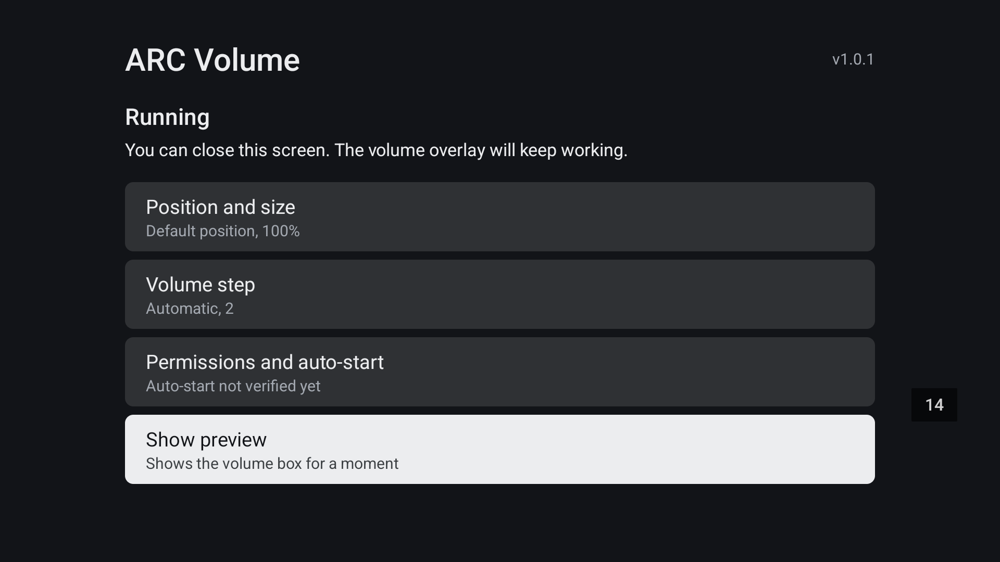
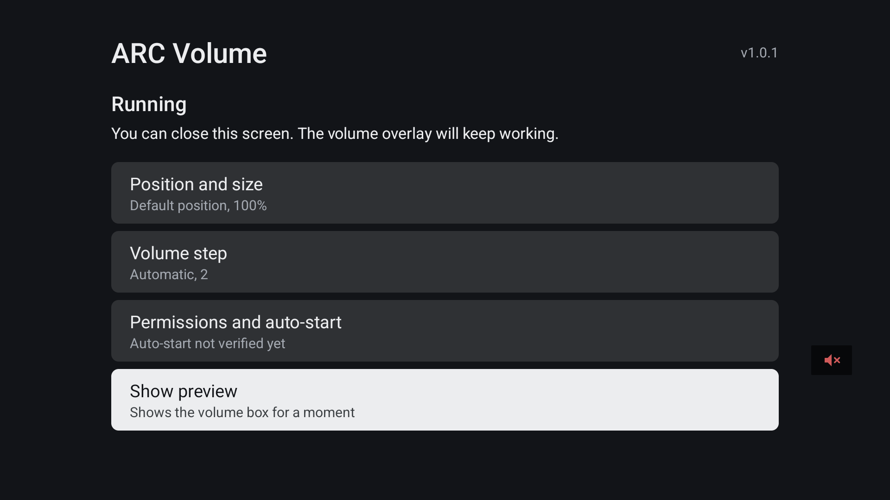
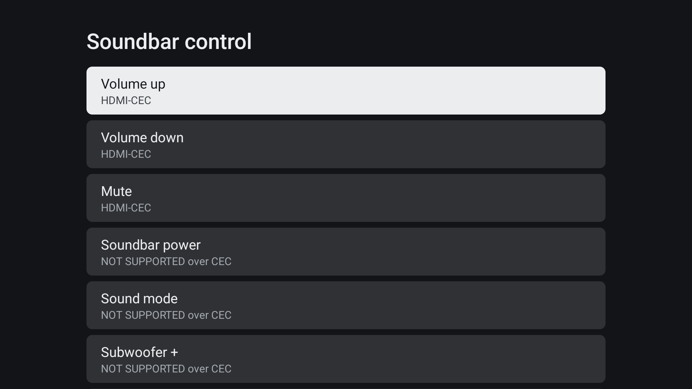
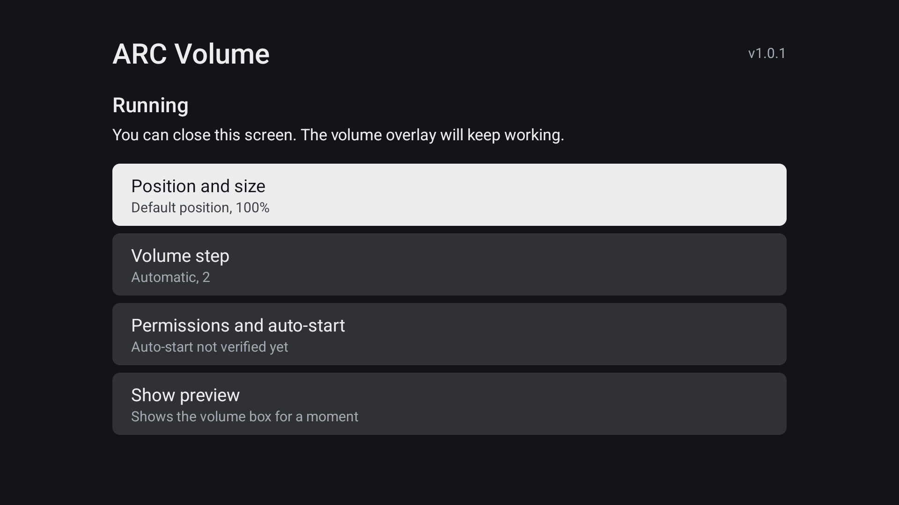

# arc-volume

> Fork of [Domanell/android-tv-arc-volume](https://github.com/Domanell/android-tv-arc-volume). MIT, with the original copyright kept in [LICENSE](LICENSE).

An Android TV app that puts the soundbar's real volume level on screen as a number. It is for the case where a
soundbar on HDMI ARC takes over the volume and the TV's own volume bar stops showing a level.

| The number | Muted |
|---|---|
|  |  |

(A soundbar reporting level 14, then mute. The small box on the right is the overlay.)

## What it does
- Listens for Android's own volume and mute broadcasts for the music stream and draws the level in a small overlay that
  hides after a moment. It does not speak CEC itself: when the TV is in ARC "full volume" mode, the TV writes the soundbar's
  reported level into that stream, and this app displays it.
- Shows only the level the soundbar reports. The number appears once the reported level has arrived, a moment after a press;
  it is never estimated. If the TV does not pass the soundbar's reports through, nothing is shown.
- Shows a crossed-out speaker when the system reports the stream as muted. You can move and scale the box.
- Needs Android 14+ and the "Display over other apps" permission. It has no internet permission and no accounts.

## What is different from upstream
- **Soundbar control panel** (`ControlActivity`): a D-pad screen with Volume up/down and Mute, sent through the normal Android
  volume calls (which the TV turns into CEC volume commands), plus power, sound mode and subwoofer rows. Those last three
  are shown as "NOT SUPPORTED over CEC" rather than pretending, because plain CEC does not carry them.
- Written notes on what CEC can and cannot do for a Samsung HW-B750 from a TCL TV
  ([docs/CEC.md](docs/CEC.md), [docs/RESEARCH.md](docs/RESEARCH.md)), a source audit ([docs/AUDIT.md](docs/AUDIT.md)) and a one-off
  real-hardware check plan ([docs/REAL_CHECK.md](docs/REAL_CHECK.md)).
- The upstream screenshots are gone; the ones here are mine. See [CHANGELOG.md](CHANGELOG.md).



## Build and install
JDK 17+ and the Android SDK (platform 34, build-tools 34.0.0). No Gradle.
```sh
bash build.sh                       # build/arc-volume-<version>.apk, debug-signed
adb -s <one device> install -r build/arc-volume-*.apk
```
Open **ARC Volume**, allow "Display over other apps", and the main screen should say Running.



Build it yourself from this source; there is no prebuilt binary here. Some TVs (TCL among them) don't start apps by
themselves after a restart: check Permissions and auto-start in the app.

## Status
Checked on a TCL Smart TV Pro (Android 14) with a Samsung HW-B750F over HDMI ARC: pressing volume up and down on the TV
remote shows the soundbar's level, and it matched the bar's own display. The app shows only the level the soundbar reports; if
the TV doesn't pass a report through, nothing is shown. Other TV and soundbar pairs are untested. Sound mode, subwoofer and
power cannot be sent over CEC from an app; `IrHaTransport` is an empty placeholder.

### Auto-start on TCL
TCL's permission shield can block apps from starting at boot. With adb connected to the TV, this worked:
`adb shell cmd appops set io.github.codemastervy.arcvolume AUTO_START allow` (also `RUN_IN_BACKGROUND` and `RUN_ANY_IN_BACKGROUND`
allow, and `cmd deviceidle whitelist +io.github.codemastervy.arcvolume`). The TV then starts the app on its own, but it delays
that by about a minute after power-on.

## Undo
`adb uninstall io.github.codemastervy.arcvolume`, or uninstall it from the TV's app settings. If you allowed auto-start through
ADB, that goes with the app.

## Credit
Original app and overlay design: Domanell (MIT).
